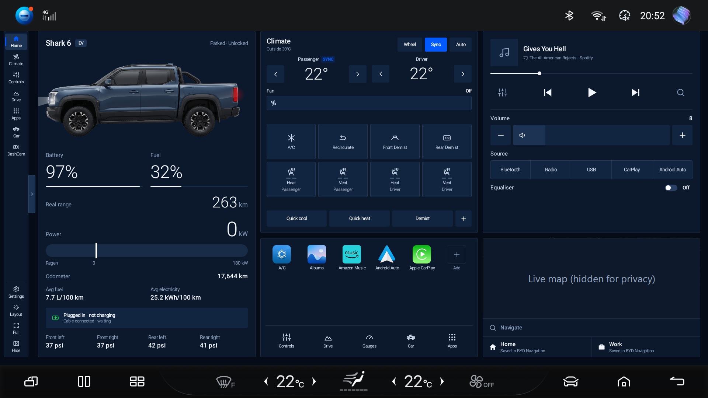
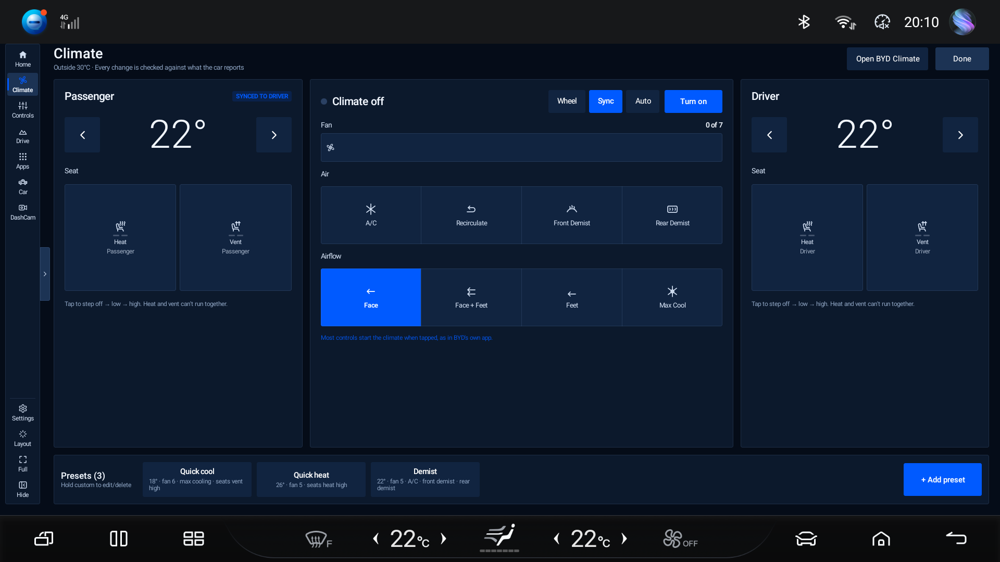
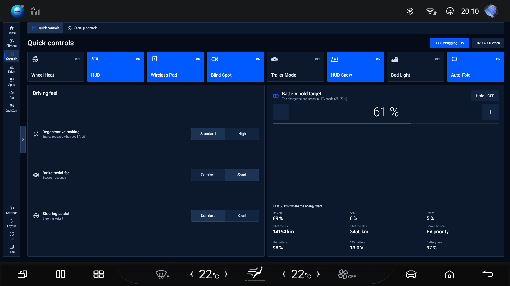
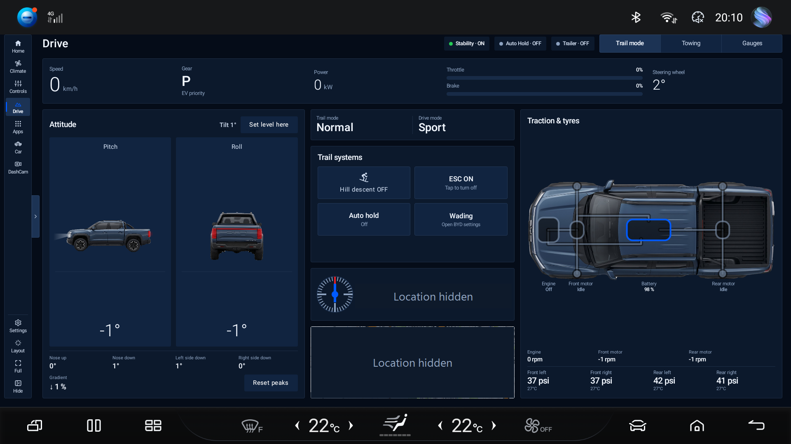
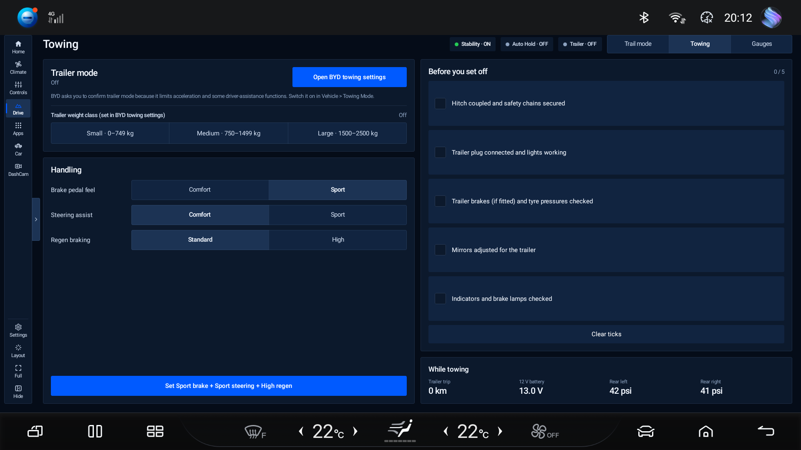
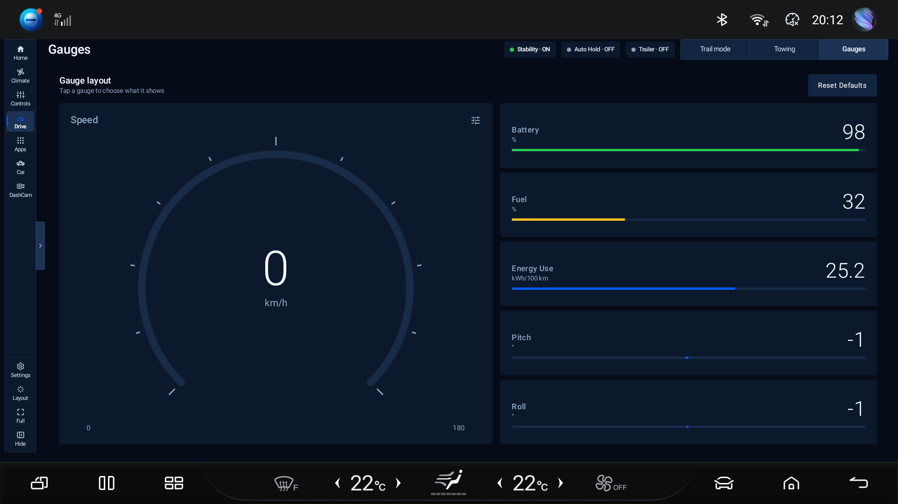
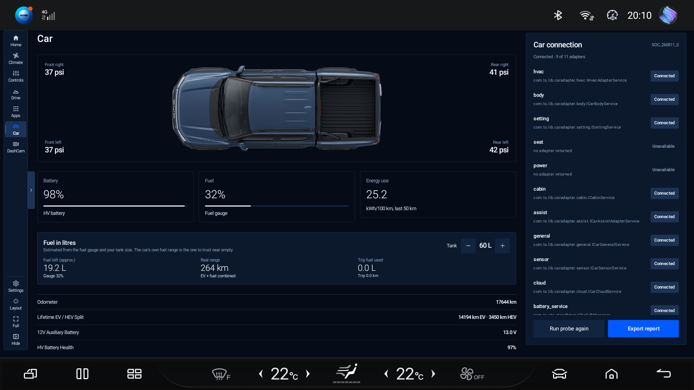
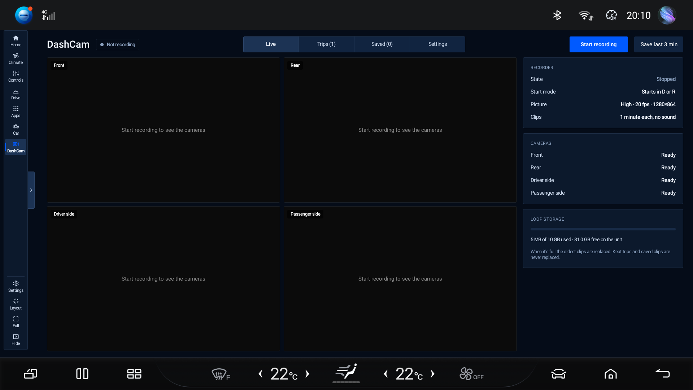
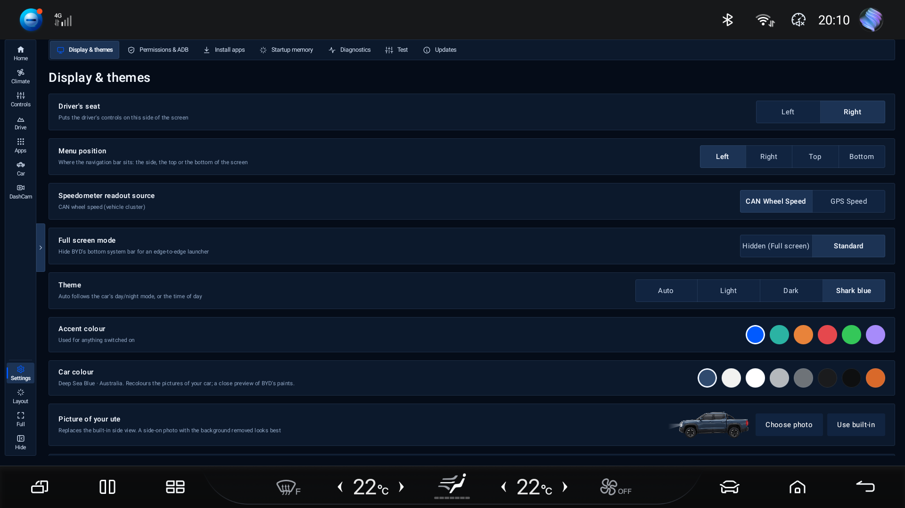

# 🦈 SharkOS CE

**A free, open-source home screen and vehicle control app for the BYD Shark 6.**

[](LICENSE)


[](https://ko-fi.com/xopticghostx)

## At a glance

| | |
| --- | --- |
| **What it is** | A free, open-source home screen and vehicle control app for the BYD Shark 6. Build your own dashboard from widgets, reach the car's own switches in one tap, and record with the built-in four-camera dash cam. It runs on the head unit, needs no account and sends nothing anywhere. |
| **Works with** | BYD Shark 6 head unit, Android 11, firmware `SOC_260811_S`. This is the only version it has been tested on; other firmware is untested. |
| **You need** | A Windows PC on the same Wi-Fi as the car (a phone hotspot works). No admin rights. |
| **Install** | 1. Download the installer from the [latest release](https://github.com/xopticghostx/SharkOS-CE/releases/latest). 2. Switch on ADB in the car (one-off). 3. Double-click `Install SharkOS CE.bat`. [Step-by-step below](#install-on-windows). |
| **Updates** | In the app, under **Settings › Updates**. Your BYD home screen stays installed, so you can switch back any time. |

**Jump to:** [Install](#install-on-windows) · [Screenshots](#screenshots) · [Safety](#safety) · [Features](#features) · [Technical reference](#technical-reference) · [Support](#support-the-project)

> ⚠️ **Use at your own risk.** This is an unofficial community project. It is not affiliated with or endorsed by BYD, and it can change some driver-assist settings. Read [DISCLAIMER.md](DISCLAIMER.md) first.



## Install on Windows

You need a Windows PC on the same Wi-Fi network as the car. No admin rights are needed.

1. **Download** the `SharkOS-CE-Installer` zip from the [latest release](https://github.com/xopticghostx/SharkOS-CE/releases/latest) and unzip it.
2. **Park the car**, switch it on, and connect it to the same Wi-Fi as your PC (a phone hotspot works).
3. **Switch on ADB (debugging) in the car.** Do this once:
   1. On the car screen go to **Car › System › Version**.
   2. Tap the words **Factory Reset** quickly, about 10 times. Tap the text itself, not the Reset button. Nothing is reset.
   3. A hidden menu opens. Rotate the screen to portrait if some options are missing.
   4. Press the button that starts **CONNECT USB TO ENABLE DEBUGGING MODE**. The car says *Turn on ADB debugging*.
   5. Rotate the screen back to landscape.
4. **Double-click `Install SharkOS CE.bat`** and follow the prompts. The installer:
   - downloads Google's ADB tool if your PC doesn't have it
   - finds the car on your network, or helps you type its IP address
   - asks you to tap **Allow** on the car screen the first time
   - installs SharkOS CE and its helper, grants the permissions it needs and opens the app
5. On the car, press **Home** and choose **SharkOS-CE** and **Always**.

Your BYD home screen stays installed and you can switch back at any time. The installer prints the exact command to do that. Once installed, SharkOS CE can update itself from this page (**Settings › Updates**).

More detail and options: [SharkOS-CE-Installer/README.md](SharkOS-CE-Installer/README.md).

## Features

### Home screen
- **Widget grid.** Widgets sit on a 12 × 8 grid. Hold a widget to edit, drag to move it, drag the handles to resize, and pick what each widget shows.
- **Ready-made layouts.** In edit mode, the **Layout** button switches between Default, Driver focus, Charging & climate, and Media & map.
- **20 widgets**, including the Shark 6 vehicle card, Climate, Media, Map, Weather, Gauge, Power, Trip, Off-road, Charging, Tyres, Tow & Trailer, Quick Controls and more.
- **Shark 6 visualiser** in your paint colour, with working headlights, brake lights and indicators.

### Quick panel
- Tap the icons at the top right, or swipe down on the status bar (full-screen mode), for a pull-down panel.
- One-tap car switches from BYD's own quick settings: HUD, HUD snow mode, wireless pad, blind spot, wheel heat, trailer mode, high regen, bed light, auto-fold mirrors, lane assist, traffic signs, speed warning, driver monitoring, child presence and hill descent.
- Wi-Fi, Bluetooth and mobile data open BYD's own settings page. Dark mode and mute switch directly.
- Your notifications, with tap to open, dismiss and clear all.

### Driving
- **Climate.** Both seats, heat and vent, fan, A/C, recirculate, airflow, demist and one-tap presets. Every change is checked against what the car reports.
- **Quick controls & BYD settings.** Large tiles for the car's switches, window open/close, Bluetooth and screen brightness, a row of BYD convenience toggles (auto-close windows, rain wiper, courtesy light, auto lock, rear demist), driving feel, battery hold target (25 to 70 %), and a dedicated **BYD settings** tab (SAVE/SPORT memory, auto lock, rain wiper/window auto-close, courtesy light, and HUD controls).
- **Trail mode.** Pitch and roll inclinometer, trail systems (hill descent, ESC, auto hold), 360° Camera button, compass, altitude and a topographic map.
- **Towing.** Trailer mode, trailer size, a before-you-set-off checklist and one-tap towing handling.
- **Gauges.** One large dial and five bar gauges, each showing the reading you choose.

### Dash cam
- Records from four cameras: front, rear and both sides.
- **Save** keeps the last 1 to 15 minutes from every camera, from any screen.
- Loop storage that replaces the oldest clips, with saved clips and trips kept.

### Car and settings
- **Car tab.** Tyre pressures, battery, fuel in litres, Trip A & Trip B, energy use, 12 V battery, battery health and the state of the car connection.
- **Themes.** Light, Dark and Shark blue. **Auto** follows BYD's light/dark mode.
- **Startup memory.** Restores your chosen settings each time the car starts.
- **Permissions & ADB, Install apps, Diagnostics, Test and Updates** pages, including a **Keep USB debugging on** switch so BYD's OTA app doesn't turn ADB off.
- **Wake helper.** Reopens SharkOS CE when the car wakes from standby. SharkOS CE installs it for you.

## Screenshots

| Climate | Quick controls |
| --- | --- |
|  |  |

| Trail mode | Towing |
| --- | --- |
|  |  |

| Gauges | Car |
| --- | --- |
|  |  |

| Dash cam | Display & themes |
| --- | --- |
|  |  |

Screenshots were taken on the car with v0.6.761. Map and location details are hidden.

## Safety

- SharkOS CE never changes a car setting by itself: only the controls you press and the settings you tick **Remember** on.
- Every write is followed by a read-back, and the screen shows the state the car reports.
- There is no built-in blocklist or speed limit, so it can also switch off safety systems such as stability control (ESC) if you choose to. New signals added to `shark6_codes.json` hit no blocklist either.
- You are responsible for what you change — check that it is legal where you drive and doesn't affect your insurance. Set things up while parked.

## Status

Developed and tested on one Shark 6 on firmware `SOC_260811_S` (Android 11). Other firmware versions are untested. Bug reports and findings from other firmware are very welcome: see [CONTRIBUTING.md](CONTRIBUTING.md).

## Technical reference

| File | Contents |
| --- | --- |
| [`BYD_SHARK6_REFERENCE.md`](BYD_SHARK6_REFERENCE.md) | Services, device classes, permissions, method names and raw value encodings for the Shark 6 head unit |
| [`app/src/main/assets/shark6_codes.json`](app/src/main/assets/shark6_codes.json) | Every car signal the app uses: read and write methods, labels, scale and notes on what was verified |

You can try new codes without rebuilding. Copy an edited `shark6_codes.json` to `/sdcard/Android/data/com.sharkhome.launcher/files/` and restart the app.

## How the wake helper works

At every standby, BYD's power service (`com.ts.appservice.power`) force-stops all user-installed apps except two whitelisted package names, `tunein.player` and `com.byd.tunein`. A force-stopped app receives no boot or screen-on broadcasts, so a launcher can't restart itself.

The `wakehelper` module is a tiny app with no screen that **uses the application ID `tunein.player`** so it stays running. It listens for the display-on event and starts SharkOS CE through a signature-protected permission, so no other app can trigger it.

- It is not the TuneIn Radio app and has no connection to TuneIn. It only reuses the package name.
- It can't be installed alongside the real TuneIn app, because they use the same package name.
- It must be signed with the same key as SharkOS CE.

## Build from source

Requirements: Android Studio with JDK 17 or 21 (Gradle 8.14 won't run on Java 25).

```bash
./gradlew :app:assembleRelease :wakehelper:assembleRelease
```

The project uses Gradle 8.14, Android Gradle Plugin 8.7 and Kotlin 2.1, with `minSdk` 29 and `targetSdk` 35. An optional Stadia Maps key can go in `local.properties` as `stadia.apiKey=...`. Without it the map uses OpenFreeMap.

## Support the project

SharkOS CE is built by one person in spare time, and it is free. Getting here took:

- **97 builds**, each one installed and checked on a real Shark 6
- **About 19,000 lines** of Kotlin written from scratch
- **175 car signals** mapped one at a time by probing the head unit and studying how BYD's own apps talk to the car, with every verified code written up in the [technical reference](BYD_SHARK6_REFERENCE.md)

If SharkOS CE makes your Shark 6 better, a donation keeps the work going. **Supporters get early access to new builds** before they are released here.

[](https://ko-fi.com/xopticghostx)

### Commissions

Want a widget or feature that isn't here yet? You can commission custom SharkOS CE widgets and features through [Ko-fi](https://ko-fi.com/xopticghostx). Finished commissions are added to SharkOS CE so every Shark 6 owner benefits.

## Credits

- **HomeSpace (Jayzee).** The car connection techniques and many BYD method names were learned by studying this app. No code from it is included.
- The steps for switching on ADB follow the community guide at [MorghusDragon/BYD-Shark-Sideloading](https://github.com/MorghusDragon/BYD-Shark-Sideloading).
- **Libraries:** AndroidX and Jetpack Compose (Apache-2.0), kotlinx.coroutines (Apache-2.0), [dadb](https://github.com/mobile-dev-inc/dadb) (Apache-2.0), [MapLibre Native](https://github.com/maplibre/maplibre-native) (BSD-2-Clause), [osmdroid](https://github.com/osmdroid/osmdroid) (Apache-2.0).
- **Map data and services:** © OpenStreetMap contributors, OpenFreeMap, OpenTopoMap (CC-BY-SA), Open-Meteo.

BYD, DiLink, Shark 6, TuneIn and other names are trademarks of their owners.

## Licence

Copyright © 2026 Nicholas Hewitt

SharkOS CE is free software: you can redistribute it and/or modify it under the terms of the GNU General Public License, version 3, as published by the Free Software Foundation. It is distributed without any warranty. See [LICENSE](LICENSE) for the full text.
